# 規格驅動輕量版測試工作流（草案 v0.3）

- **狀態**：草案（Draft），尚未實作
- **日期**：2026-11-24
- **依據文件**：
  - `software-testing-workflow.md`：UT → Smoke → SIT 階段閘門、Entry/Exit 結構、Mermaid＋ASCII 雙圖示與 `S1–S4` 缺陷嚴重度
  - `existing-project-test-workflow.md`（v0.4）：完整既存專案測試導入工作流（本草案為其規格驅動精簡版）
  - `docs/00_software-testing-types.md`：九種測試類型三維分類、V-Model 與測試金字塔
  - `web-cicd-pipeline.md`：確定性腳本執行、Exit Code 與標準化 Defect 指紋
  - `../Workflow-for-Agent/workflow.md`：GWT 可測性、7 類邊界與 `T-R*` 命名規範
- **適用範圍**：已具備 Spec 文件（PRD、規格書、OpenAPI/Schema 等），希望以最小流程成本完成「測試計劃與案例 → 自動化腳本 → 實際測試 → CSV 報告與 Issue 列表」之專案；**不包含修改業務程式碼**
- **變更紀錄**：
  - `v0.1`：依據 `existing-project-test-workflow.md` v0.4 產出四階段輕量版草案
  - `v0.2`：拍板四項規則——Stage 1 產物暫存 `.scratch/planning/`、模糊項列 `PND-xx` 表列報告內、Stage 3 腳本修正重試上限 3 次、Stage 4 統一輸出 CSV
  - `v0.3`：參照 `software-testing-workflow.md` 重構文件結構與可讀性——新增 Mermaid 主流程圖與精簡 ASCII 詳細路徑圖；Stage 3 執行對齊 **UT → Smoke Gate → SIT** 閘門與進出條件；導入 **`S1–S4` 缺陷嚴重度與 Gate 判定規則**；各階段統一採用「負責／進入／執行／離開」卡片格式並補入預設前提

---

## 0. 決策摘要

| # | 決策項目 | 結論 |
|---|---|---|
| 1 | 規劃來源邊界 | **Stage 1 僅限讀取 Spec**：禁止讀取待測程式碼，從源頭杜絕「照著 Bug 寫預期」的確認偏誤 |
| 2 | 模糊與缺漏處理 | 不因局部模糊中斷流程：先以 `ASSUMPTION` 標記 `PND-xx`，彙整為**「待確認事項」表列於 Stage 4 報告內** |
| 3 | 規劃產物留存 | Stage 1 計劃與案例規格採**暫存**策略（置於 `.scratch/planning/`，不納入 `docs/` 版控） |
| 4 | 程式碼介入時機 | **Stage 2 始得讀取待測碼**：僅用於對接介面（簽章、API、選擇器、Mock），**嚴禁回改 Stage 1 預期斷言** |
| 5 | 執行閘門與重試 | **Stage 3 依 `UT → Smoke Gate → SIT` 執行**；僅 `TEST_DEFECT`/`ENV_DEFECT` 可修腳本重試，**每案上限 3 次**；不改業務碼 `src/` |
| 6 | 輸出與嚴重度 | Stage 4 統一**輸出 CSV**（UTF-8 with BOM、RFC 4180），缺陷採用 **`S1–S4`** 嚴重度作為 Go / No-Go 依據 |

---

## 1. 流程總覽（Mermaid ＋ ASCII）

### 1.1 Mermaid 流程圖

```mermaid
flowchart TD
    START(["● START<br/>輸入：Spec 文件（PRD / 01_spec.md / OpenAPI）<br/>※ 硬性邊界：Stage 1 嚴禁讀取 src/"])

    subgraph ST1["Stage 1：根據 Spec 設計測試計劃與案例"]
        direction TB
        S1_INFO["負責：QA / Test Designer<br/>只讀：Spec 文件｜暫存：.scratch/planning/"]
        S1_RUN["執行：盤點模糊項標記 PND-xx<br/>→ 產出測試計劃（P0–P2 / 三維配置）<br/>→ 產出 GWT 測試案例與 7 類 EC 邊界"]
        S1_EXIT["離開：案例皆具可斷言之 Then 與 T-R* ID"]
        S1_INFO --> S1_RUN --> S1_EXIT
    end

    subgraph ST2["Stage 2：撰寫自動化測試腳本"]
        direction TB
        S2_INFO["負責：Test Author<br/>讀取：Stage 1 案例 ＋ Spec ＋ 待測程式碼 src/"]
        S2_RUN["執行：對接簽章 / API / Selector / Mock 隔離<br/>→ 撰寫 tests/**（保留 PND-xx 標記）<br/>→ 衝突維持原斷言；缺介面標 TESTABILITY_BLOCKER"]
        S2_EXIT["離開：≥1 斷言、禁 .only / sleep、@smoke ≤ 15 條"]
        S2_INFO --> S2_RUN --> S2_EXIT
    end

    subgraph ST3["Stage 3：分層漏斗測試執行（不修改業務碼）"]
        direction TB
        UT_RUN["[3A] UT 層（L0 靜態 ＋ L1 Unit）<br/>Mock 外部依賴 → 靜態分析 → 覆蓋率量測"]
        G_UT{"Gate UT<br/>通過率 100% / 門檻達成？"}

        BUILD["Build / 啟動待測環境 ＋ Healthcheck 200 OK"]
        G_SMOKE{"Smoke Gate<br/>@smoke ≤15條、≤5m 通過？"}

        SIT_RUN["[3B] SIT 層（L2 Integ ＋ L5 E2E/Regression ＋ L6 選用非功能）<br/>API/DB 契約 → E2E 旅程 → Regression → 選用效能/a11y"]
        G_SIT{"Gate SIT<br/>執行 100%、無未處理異常？"}

        UT_RUN --> G_UT
        G_UT -- "✓ Yes" --> BUILD --> G_SMOKE
        G_SMOKE -- "✓ Yes" --> SIT_RUN --> G_SIT
    end

    RETRY_CHK{"失敗原因與重試次數？"}
    FIX_SCRIPT["回 Stage 2 修測試腳本 / 環境<br/>（單案累計 ≤ 3 次）"]

    subgraph ST4["Stage 4：產出 CSV 報告與 Issue 列表"]
        direction TB
        S4_OUT["產出：.scratch/reports/<br/>• test_report.csv ＋ test_report_summary.csv<br/>• test_report_pending.csv（待確認事項 PND-xx）<br/>• issues.csv（S1–S4 分級＋日誌片段）"]
        S4_DEC["後續決策（流程外人工裁決）：<br/>• 無 S1/S2 且 PND 已清 → Go-Live<br/>• IMPL_DEFECT → 交開發修碼<br/>• SPEC_DRIFT / PND → 改 Spec ↺ Stage 1"]
        S4_OUT --> S4_DEC
    end

    END_(["● END"])

    %% 主線（連入框內起迄節點，確保版面整齊）
    START --> S1_INFO
    S1_EXIT --> S2_INFO
    S2_EXIT --> UT_RUN
    G_SIT -- "✓ Yes" --> S4_OUT
    S4_DEC --> END_

    %% 失敗與重試迴路
    G_UT -- "✗ No" --> RETRY_CHK
    G_SMOKE -.->|"✗ No：Abort SIT，直接報錯"| S4_OUT
    G_SIT -- "✗ No" --> RETRY_CHK
    RETRY_CHK -- "TEST/ENV_DEFECT 且 ≤ 3 次" --> FIX_SCRIPT -.->|"↺ 重跑對應層"| S2_RUN
    RETRY_CHK -- "IMPL_DEFECT / SPEC_DRIFT / 超 3 次 / XPASS" --> S4_OUT

    classDef gate fill:#fff4d6,stroke:#d4a017,color:#000
    classDef fail fill:#fde2e2,stroke:#c0392b,color:#000
    classDef term fill:#e0f0ff,stroke:#2c6fbb,color:#000
    classDef report fill:#e3f7e3,stroke:#2e8b57,color:#000

    class G_UT,G_SMOKE,G_SIT,RETRY_CHK gate
    class FIX_SCRIPT fail
    class START,END_ term
    class BUILD,S4_OUT,S4_DEC report
```



### 1.2 ASCII 版本（終端機檢視用）

#### 總覽

```text
  [Spec] ─► Stage 1(計畫+案例) ─► Stage 2(寫腳本) ─► Stage 3(UT ─► Smoke ─► SIT) ─► Stage 4(CSV 報告+Issues)
                ▲                     ▲                    │                           │
                │                     └─ TEST/ENV ≤ 3次 ───┘                           │
                └────────────── 後續若需修訂 Spec（Change Request）────────────────────┘
```

#### 詳細路徑圖

```text
 ● START ─ 輸入 Spec（PRD / 01_spec.md / OpenAPI）
 │         ※ 硬性邊界：Stage 1 嚴禁讀取待測程式碼（src/）
 ▼
 ┏━━ [Stage 1] 測試計劃與案例設計 ━━━━━━━━━━━━━━━━━━━━━━━━━━━━
 ┃ 負責：QA / Test Designer     暫存：.scratch/planning/（不入 docs/）
 ┃ 執行：模糊項標記 PND-xx → P0–P2 測試計劃 → GWT 案例 + 7 類 EC
 ┃ 離開：每個案例皆有 T-R* ID 與可客觀斷言之 Then
 ┗━━━━━━━━━━━━━━━━━━━━━━━━━━━━━━━━━━━━━━━━━━━━━━━━━━━━━━━━━━━━
 │
 ▼ （納入待測程式碼 src/，嚴禁回改 Stage 1 預期斷言）
 ┏━━ [Stage 2] 自動化腳本實作 ━━━━━━━━━━━━━━━━━━━━━━━━━━━━━━━━
 ┃ 負責：Test Author            產出：tests/**
 ┃ 執行：對接簽章/API/選擇器/Mock → 寫腳本（衝突維持原預期）
 ┃ 離開：≥1 斷言、無 .only / sleep、@smoke ≤ 15 條
 ┗━━━━━━━━━━━━━━━━━━━━━━━━━━━━━━━━━━━━━━━━━━━━━━━━━━━━━━━━━━━━
 │
 ▼
 ┏━━ [Stage 3] 分層漏斗執行（確定性腳本，不改業務碼） ━━━━━━━━
 ┃ 環境：Local / Container / shared-staging（資料帶 TEST_<run_id>_）
 ┃
 ┃ [3A] UT 層（L0 靜態 + L1 Unit）
 ┃ ◆ Gate UT：通過率 100% / 覆蓋達標？
 ┃   ├─ ✗ TEST/ENV_DEFECT (≤3次) ─► 回 Stage 2 修腳本/環境 ↺ 重跑
 ┃   └─ ✓ Yes ─► Build / 啟動環境 ─► Healthcheck 200 OK
 ┃
 ┃ ◆ Smoke Gate（@smoke ≤ 15 條、≤ 5 分鐘）
 ┃   ├─ ✗ No ─► 立即中止！略過 SIT，直接送 Stage 4 產報表
 ┃   └─ ✓ Yes
 ┃
 ┃ [3B] SIT 層（L2 Integ + L5 E2E/Regression + L6 選用非功能）
 ┃ ◆ Gate SIT：執行率 100%、無未歸類失敗？
 ┃   ├─ ✗ TEST/ENV_DEFECT (≤3次) ─► 回 Stage 2 修腳本/環境 ↺ 重跑
 ┃   └─ ✗ IMPL_DEFECT / SPEC_DRIFT / 超 3 次 / XPASS ─► 送 Stage 4
 ┗━━━━━━━━━━━━━━━━━━━━━━━━━━━━━━━━━━━━━━━━━━━━━━━━━━━━━━━━━━━━
 │
 ▼
 ┏━━ [Stage 4] 產出 CSV 報告與 Issue 列表 ━━━━━━━━━━━━━━━━━━━━
 ┃ 編碼：UTF-8 with BOM、RFC 4180 標準逗號分隔 CSV
 ┃ 產出（.scratch/reports/）：
 ┃  ├─ test_report.csv         （案例明細主表）
 ┃  ├─ test_report_summary.csv （UT / Smoke / SIT 分層統計）
 ┃  ├─ test_report_pending.csv （待確認事項 PND-xx ＋ 實測表現）
 ┃  └─ issues.csv              （S1–S4 嚴重度、重現指令、25-50 行 log）
 ┗━━━━━━━━━━━━━━━━━━━━━━━━━━━━━━━━━━━━━━━━━━━━━━━━━━━━━━━━━━━━
 │
 ● END ─ 交由人工依 CSV 決定 Go-Live / 開發修碼 / 變更 Spec
```

---

## 2. 設計原則與版本取捨

### 2.1 四條核心原則

1. **資訊防火牆**：Stage 1 只讀 Spec，Stage 2 才讀待測碼對接介面，**絕不回頭修改 Stage 1 的 `Then` 預期值去迎合程式實作**。
2. **模糊不硬擋，實測給參考**：Spec 模糊或缺細節時不卡關，先以顯性 `ASSUMPTION`（`PND-xx`）照常推進實測，於 Stage 4 報告並列「當時假設 vs 程式實際表現」供一次確認。
3. **有界重試與不改業務碼**：僅測試腳本寫錯或環境問題允許回 Stage 2 修正（**每案上限 3 次**）；實作缺陷與規格衝突一律保留證據輸出至 `issues.csv`。
4. **確定性證據與輕量暫存**：執行判定取自 JSON/SARIF 與 Exit Code；規劃草稿與 CSV 報告集中於 `.scratch/`，僅將可重用的 `tests/**` 納入專案版控。

### 2.2 與完整版（`existing-project-test-workflow.md` v0.4）之取捨

| 面向 | 完整版（`existing-project-test-workflow.md` v0.4） | 輕量版（本草案 v0.3） |
|---|---|---|
| **規劃資料來源** | Spec ＋ 程式碼 ＋ Git 熱點 ＋ 既有測試基線 | **僅限 Spec**（Stage 2 才讀程式碼對接） |
| **版控閘門檔案** | 4 份版控 YAML（`scope/gaps/plan-gate/triage`）＋ PR 閘門 | **全規劃產物暫存 `.scratch/planning/`** |
| **Spec 模糊處理** | `assumed` 未人工確認即回 Exit `5` 阻擋 | 標記 `PND-xx` 繼續執行，**表列於 `test_report_pending.csv`** |
| **前置掃描與骨架** | 需 `recon.mjs`、`baseline.mjs`、`scaffold.mjs` | **省略**（模型／人直接讀 Spec 設計並於 Stage 2 寫腳本） |
| **無規格遺留區** | 支援 M0/M1 無 Spec 專案（`T-CHR-*` 特徵測試） | **不適用無 Spec 專案**（至少須具備核心功能 Spec） |
| **重試與修碼閉環** | 含 `Code Fixer` 修 `src/` 與 Wave 0–3 推進 | **不改 `src/`**；僅 `TEST/ENV_DEFECT` 限修腳本 **最多 3 次** |
| **輸出報告載體** | `.scratch/reports/test_report.md` ＋ CI 摘要 | **標準化 CSV 組**（`test_report*.csv` ＋ `issues.csv`） |

---

## 3. 各階段詳細規範

### 3.1 Stage 1：根據 Spec 設計測試計劃與測試案例

| 階段卡片 | 內容 |
|---|---|
| **負責角色** | QA / Test Designer（可由獨立上下文 AI 代理執行） |
| **進入條件** | 取得目標專案之 Spec 文件（PRD、`01_spec.md`、OpenAPI/Swagger、DB/GraphQL Schema） |
| **讀取限制** | **嚴禁讀取 `src/`、`server/`、`app/`、既有測試檔或 Git 實作細節** |
| **暫存路徑** | `.scratch/planning/`（不寫入版控 `docs/`） |
| **離開條件** | 完成測試計劃、風險分級（`P0–P2`）、GWT 案例（具 `T-R*` ID 與具體 `Then`）及 `PND-xx` 清單 |

#### (1) Spec 模糊項處理（不中斷原則）
- 僅在專案**完全無可辨識之功能輸入輸出 Spec** 時中止要求補件。
- 遭遇局部模糊用語（`TBD`、`待定`、`適當`、`快速`、`合理` 等）或漏寫異常/邊界數值時，先採合理業務常規建立暫定 **`ASSUMPTION`**，並編為 **`PND-xx`** 登錄於待確認清單，不阻斷後續流程。

#### (2) 初步測試計劃內容
1. **範圍清單**：納入與排除（Out-of-Scope）之 Spec 來源與 `FR-xx`。
2. **業務風險分級（依 Spec 重要性）**：
   - **P0（核心關鍵）**：認證、金流、權限、核心寫入 → 必測正常＋異常＋7 類邊界＋納入 `@smoke` 與 `@e2e`。
   - **P1（主要功能）**：主要 CRUD 與整合串接 → Unit ＋ Integration ＋ 關鍵 `@e2e`/`@regression`。
   - **P2（輔助邊緣）**：次要設定與查詢 → Unit 或基礎契約測試。
3. **三維測試類型配置表（對齊 `docs/00_software-testing-types.md`，含非 Web 注記）**：

   | 測試類型 | 維度 | 本專案目標對象 | 建議工具 / Tag（含非 Web 注記） |
   |---|---|---|---|
   | **Unit** | Level: Unit | 純業務運算、驗證器、狀態轉換（無外部 IO） | Vitest / Pytest<br>_（非 Web：原生 `pytest`、`go test` 等）_ |
   | **Integration** | Level: Integration | API 契約、DB 交易與異常錯誤處理<br>_（非 Web：Subprocess/Pipe、DB/管線契約）_ | Vitest / Pytest + Container<br>_（非 Web：Testcontainers / 暫存沙盒）_ |
   | **Smoke** | Trigger: Smoke | Healthcheck、登入與 1–2 條 P0 主路徑（**≤ 15 條、≤ 5 分鐘**）<br>_（非 Web：CLI `--help`/主指令、管線最小樣本）_ | Playwright `@smoke`<br>_（非 Web：CLI/API 冒煙腳本，同標 `@smoke`）_ |
   | **E2E** | Type: Functional | 跨頁面／跨服務完整使用者旅程（`retries: 0`）<br>_（非 Web：完整 CLI 工作流或 Golden 輸出比對）_ | Playwright `@e2e`<br>_（非 Web：CLI runner 端到端實測）_ |
   | **Regression** | Trigger: Regression | P0/P1 核心回歸測試集 | `@regression`（跨 Web 與非 Web 通用） |
   | **Sanity** | Trigger: Sanity | 局部修正之窄而深快速驗證 | 模組 Tag（如 `@auth` / `@order`） |
   | **Load / Stress** | Type: Non-functional | [選用] 關鍵端點 SLA（p95）與容量壓力<br>_（非 Web：吞吐量與記憶體壓測）_ | k6<br>_（非 Web：Locust / `pytest-benchmark` / `hyperfine`）_ |
   | **Usability** | Type: Non-functional | [選用] a11y / Lighthouse / 易用性檢核<br>_（非 Web：文件與錯誤訊息 DX；無 UI 標 `N/A`）_ | axe-core / LHCI / 人工記錄<br>_（非 Web：DX 檢核清單）_ |

4. **環境與 Mock 假設**：定義哪些外部依賴（金流、簡訊等）使用 Mock/Stub，哪些使用真實容器或受測環境。

#### (3) 測試案例設計規格
- **ID 命名**：正常類 `T-R1-AC-xx`、規格異常類 `T-R2-AC-xx`、7 類邊界 `T-R2-EC-xx`（空值、極大值、非法格式、網路逾時、資料遺失/斷線、併發衝突、權限不足；不適用標 `N/A + 理由`）。
- **必填欄位**：`Test ID`、`來源(FR/AC/NFR)`、`優先級(P0–P2)`、`Tag`、`pending_id(若有)`、`前置條件/資料`、`Given / When / Then`（`Then` 須含明確狀態碼、資料值或畫面關鍵字）。

> **可選人工快檢**：完成後可直接進 Stage 2，或由人工快速確認暫存計劃中的 `P0` 範圍與 `PND-xx` 方向後放行。

---

### 3.2 Stage 2：依據測試案例、Spec 及待測程式碼撰寫自動化腳本

| 階段卡片 | 內容 |
|---|---|
| **負責角色** | Test Author（若與 Stage 1 分離為獨立上下文更佳） |
| **進入條件** | 取得 Stage 1 測試計劃、測試案例、`PND-xx` 清單，以及原始 Spec |
| **讀取範圍** | Stage 1 產物 ＋ Spec ＋ **待測程式碼 `src/`**（限對接用途） |
| **產出路徑** | `tests/unit/`、`tests/integration/`、`tests/e2e/`、`tests/load/`（入版控） |
| **離開條件** | 腳本靜態自檢通過：≥ 1 有效斷言、無 `.only` / 固定 `sleep`、Tag 完整、`@smoke ≤ 15` 條 |

#### (1) 讀碼 4 項白名單用途
1. 確認匯入路徑、函式簽章、型別、HTTP 路由與請求/回應結構。
2. 確認 DOM 定位屬性（優先 `getByRole` / `getByLabel` / `data-testid`）、DB Schema、環境變數與 Healthcheck 端點。
3. 完成 Mock / DI / Testcontainers 接線與資料隔離（若使用共享環境 `shared-staging`，測試資料強制加 `TEST_<run_id>_` 前綴並於結束清理，嚴禁全庫清空）。
4. 保留 `PND-xx` 標記於對應測試註解或 Tag，供 Stage 4 報表勾稽。

#### (2) 防弊鐵律（嚴禁回改預期值）

| 對接異常情境 | 正確處置方式 | 嚴禁行為 |
|---|---|---|
| **程式碼與 Stage 1 預期矛盾**<br>（如 Spec 寫 400，碼寫 500） | **忠實依 Stage 1 `Then` 寫出斷言**（讓 Stage 3 如實測出失敗）；或依約標註 `test.fail()` 並記錄衝突原因交 Stage 4 | 把斷言偷改成 `expect(status).toBe(500)` |
| **程式碼缺測試接口**<br>（缺端點、無勾子、強耦合難 Mock） | 標註 `TESTABILITY_BLOCKER` 並記錄檔案位置與原因，送交 Stage 4 `issues.csv` | 私自大幅修改或重構業務碼 `src/` |

---

### 3.3 Stage 3：確定性分層執行（UT → Smoke Gate → SIT）

| 階段卡片 | 內容 |
|---|---|
| **負責角色** | Script Runner（確定性測試執行器，不以 AI 判定通過） |
| **環境要求** | 鎖定 `target_sha`；確認 DB / Seed 就緒且與生產環境完全隔離 |
| **進入條件** | 通過 Stage 2 腳本靜態自檢（`L0`） |
| **離開條件** | 依序完成 **UT → Smoke Gate → SIT**；所有失敗皆已區分原因（且 `TEST/ENV_DEFECT` 重試 ≤ 3 次）；產出 JSON 報表與 Raw Log 至 `.scratch/` |

#### (1) 分層執行與閘門基準

| 層級與階段 | 涵蓋測試 | 執行與閘門參考基準（可依專案調整） | 未通過時處理方式 |
|---|---|---|---|
| **3A. UT 層**<br>（`L0` 靜態 ＋ `L1` Unit） | 靜態語法/Lint/無 `.only` ＋ `T-R1-*` 單元測試（Mock 外部依賴） | 通過率 `100%`；Line 覆蓋率參考 `≥ 80%`；無嚴重靜態錯誤 | 屬腳本或設定錯 → 回 Stage 2 修正重跑（**上限 3 次**）；屬程式邏輯錯 → 記錄並視情況續跑或直入 Stage 4 |
| **入口閘門**<br>（`L3` Build ＋ `L4` Smoke） | 打包／起站 Healthcheck `200 OK` ＋ `@smoke`（**≤ 15 條、≤ 5 分鐘**） | Healthcheck 通過且 `@smoke` **100% 通過** | **失敗立即中止！** 略過耗時之 SIT，將證據直接送 Stage 4 產出 `S1` 阻擋報告 |
| **3B. SIT 層**<br>（`L2` Integ ＋ `L5` E2E/Regression ＋ `L6` 選用非功能） | API/DB 契約整合、7 類 EC、跨頁 E2E（`retries: 0`）、Regression（可選雙跑防抖）及選用 k6 / a11y | 案例執行率 `100%`；參考通過率 `≥ 95%`；無未記錄之異常 | 屬 `TEST_DEFECT`/`ENV_DEFECT` → 回 Stage 2 修該層腳本/環境並重跑對應回歸（**上限 3 次**）；其餘全部彙整進 Stage 4 |

> **局部驗證快捷通道**：若僅驗證小範圍修正，通過 `L0` 與 `L3/Smoke` 後，可只執行受影響模組 Tag 之 **`Sanity` ＋ 受影響範圍 `Regression`**。

#### (2) 重試上限與 Exit Code 規則
- **有界重試（Max Retries = 3）**：
  - 僅 **`TEST_DEFECT`**（Selector 拼錯、Mock 漏欄位等腳本錯）與 **`ENV_DEFECT`**（服務啟動或連線配置異常）允許修正重試，單一失敗案例**上限 3 次**。
  - **超過 3 次仍敗**：強制停止重試，連同 3 次歷程直接輸出至 Stage 4 `issues.csv`（分類為 `SCRIPT_RETRY_EXHAUSTED` 或 `ENV_DEFECT`）。
  - **`IMPL_DEFECT`（實作缺陷）與 `SPEC_DRIFT`（規格實作衝突）**：**重試次數 = 0**，不改業務碼亦不重改預期，直接留存證據進 Stage 4。
- **`test.fail()` 與 `XPASS`**：預先標註 `test.fail()` 的測試若意外通過（`XPASS`），標記為 `XPASS_CLEANUP`（不計為失敗或重試次數），列入 `issues.csv` 提醒移除標記。
- **Exit Code 對齊**：`0` 通過、`1` 含測試失敗、`2` 未達覆蓋/門檻、`3` Flaky（雙跑不一致）、`6` 環境或工具錯、`7` `XPASS` 清理提醒。

---

### 3.4 Stage 4：產出 CSV 報告及 Issue 列表

| 階段卡片 | 內容 |
|---|---|
| **進入條件** | Stage 3 執行完畢（或於 Smoke Gate 中止）並備妥 `.scratch/` JSON 報表與 Raw Log |
| **輸出格式** | **RFC 4180 標準、UTF-8 with BOM（`\uFEFF`）編碼之 CSV**（Excel / Google Sheets 直接相容；空值留空字串） |
| **離開條件** | 產出四張關聯 CSV 至 `.scratch/reports/`，供人工依 `S1–S4` 與 `PND-xx` 裁決 Go-Live / 修碼 / 改 Spec |

#### (1) 缺陷嚴重度定義（`issues.csv` 與 Gate 判斷依據）

| 等級 | 定義 | 後續 Gate / 決策建議 |
|---|---|---|
| **`S1 Critical`** | 系統當機、資料毀損、資安洩漏、核心鏈路（`@smoke`）失敗且無替代方案 | **必須修復**（建議 No-Go / 阻擋上線） |
| **`S2 Major`** | 主要功能（`P0/P1`）失效，但有替代方案 | **必須修復**（建議 No-Go / 阻擋上線） |
| **`S3 Minor`** | 次要功能（`P2`）異常，影響範圍有限 | 可帶著放行，須排入後續修復計畫 |
| **`S4 Trivial`** | UI 微調或提示文字等外觀問題 | 排入後續版本優化 |

#### (2) 測試報告 CSV 檔案組（`.scratch/reports/`）

1. **`test_report.csv`（案例執行明細主表，一列一測試案例）**：
   - `run_id`, `target_sha`, `executed_at`, `env_mode`（`isolated` / `shared-staging`）
   - `stage_layer`（`UT` / `SMOKE` / `SIT-INTEG` / `SIT-E2E` / `SIT-REG` / `SIT-NF`）, `test_id`, `spec_ref`, `priority`（`P0–P2`）, `tags`
   - `script_path`, `status`（`PASS`/`FAIL`/`SKIP`/`BLOCKED`/`FLAKY`/`XPASS`）, `retry_attempts`（`0–3`）, `duration_ms`
   - `pending_id`（如 `PND-01`）, `is_pending`（`true`/`false`）, `issue_key`, `skip_or_block_reason`, `raw_log_ref`
2. **`test_report_summary.csv`（分層統計摘要表）**：
   - `run_id`, `overall_status`（`PASS` / `FAIL` / `ABORTED_AT_SMOKE`）, `exit_code`
   - `stage_layer`（`UT` / `SMOKE` / `SIT` / `ALL`）, `total`, `passed`, `failed`, `skipped`, `blocked`, `flaky`, `xpass`
   - `line_cov_pct`, `branch_cov_pct`, `pending_count`, `s1_s2_open_count`, `issue_count`
3. **`test_report_pending.csv`（報告內嵌「待確認事項」專表）**：
   - 彙整所有 Stage 1 的 `PND-xx` 假設，並附上 Stage 3 實測觀察，方便人工對照拍板：
   - 欄位：`pending_id`, `source_spec`, `ambiguity_type`（`VAGUE_TERM` / `MISSING_ERROR_SPEC` / `MISSING_BOUNDARY`）, `original_text`, `assumption_used`, `linked_test_ids`, `stage3_observed_behavior`, `test_outcome`, `decision_needed`

#### (3) Issue 列表 CSV（`.scratch/reports/issues.csv`）

依指紋 `sha256(layer + test_id + normalized_error + file)` 去重，涵蓋 Stage 2 可測性阻礙與 Stage 3 所有最終異常：
- **識別與分類**：`issue_key`（如 `ISS-20261124-a1b2c3`）、`fingerprint`、`category`（`IMPL_DEFECT` | `SPEC_DRIFT` | `TESTABILITY_BLOCKER` | `ENV_DEFECT` | `FLAKY` | `SCRIPT_RETRY_EXHAUSTED` | `XPASS_CLEANUP`）、`severity`（`S1 Critical` | `S2 Major` | `S3 Minor` | `S4 Trivial`）
- **追溯與細節**：`spec_ref`、`test_id`、`pending_id`（若源自 `PND-xx`）、`location`（`file:line`）、`expected`（Stage 1 `Then`）、`actual`（實測結果）
- **重現與建議**：`retry_attempts`（`0–3`）、`repro_cmd`、`log_snippet`（失敗前後 25–50 行精華，雙引號跳脫）、`suggested_action`（修業務碼 / 改 Spec / 補可測介面 / 修環境 / 拆 `test.fail()`）

---

## 4. 目錄與版控邊界

可由單人搭配 AI 執行，或拆為兩個獨立上下文（**上下文 A 負責 Stage 1，上下文 B 負責 Stage 2–4** 以確保資訊隔離）。

```text
project/
├── tests/                                    # [納入版控] Stage 2 產出之自動化測試腳本
│   ├── unit/                                 # T-R1-* / 單元邊界
│   ├── integration/                          # T-R2-* / 服務契約
│   ├── e2e/                                  # @smoke（≤15 條）與 @e2e（retries: 0）
│   └── load/                                 # [選用] k6 壓測腳本
└── .scratch/                                 # [.gitignore 排除，全暫存不入版控]
    ├── planning/                             # Stage 1 暫存：測試計劃、測試案例與 PND-xx 清單
    ├── logs/                                 # Stage 3 原始執行日誌（含各次重試 log）
    └── reports/                              # Stage 3 JSON 報表 ＋ Stage 4 CSV 產物：
        ├── test_report.csv                   #   案例執行明細主表
        ├── test_report_summary.csv           #   UT / Smoke / SIT 分層摘要表
        ├── test_report_pending.csv           #   待確認事項專表（PND-xx ＋ 實測結果）
        └── issues.csv                        #   S1–S4 去重 Issue 列表
```

---

## 5. 預設前提與已知限制

1. **單輪階段式定位**：本流程採單輪驅動（非每個 Agile Sprint 全套持續維運）；若需多波段 Ratchet、Git 熱點追蹤與自動 PR 阻擋，請接軌 `web-cicd-pipeline.md` 或切回 `existing-project-test-workflow.md`。
2. **參考門檻可依專案調整**：UT 覆蓋率 80% 與 SIT 通過率 95% 為業界常見參考預設，實務上應依專案成熟度調整（但 `@smoke` 與 `S1/S2` 阻擋原則建議保留）。
3. **非功能測試預設併入 SIT**：效能（k6）與安全／無障礙（a11y/LHCI）預設放在 SIT 層視需要執行；若專案高度重視效能或資安，可獨立拆為專屬階段。
4. **Spec 依賴度與 CSV 拆表**：完全無可用 Spec 的專案不適用本流程；此外因單一 RFC 4180 CSV 不適合混雜多種欄位結構，報告依 `run_id` 與 `pending_id` 拆為三張關聯 CSV 以確保相容性。
