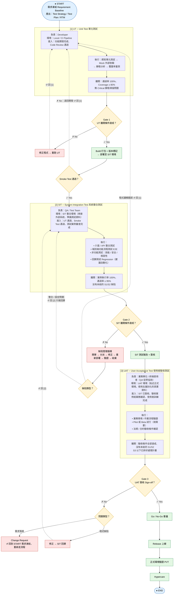

# 軟體測試流程：UT → SIT → UAT



## ASCII 版本（終端機檢視用）

### 總覽

```
  UT ──[G1]──► SIT ──[G2]──► UAT ──[G3]──► Go-Live
  ▲             │▲            │
  └── defect ───┘└── defect ──┘
```

### 詳細路徑圖

```
 ●  START ─ 需求凍結（Requirement Baseline）
 │          產出：Test Strategy、Test Plan、RTM（需求追溯矩陣）
 │
 ▼
 ┏━━ [1] UT ─ Unit Test 單元測試 ━━━━━━━━━━━━━━━━━━━━━━━━━━━━━━
 ┃  負責：Developer
 ┃  環境：Local / CI Pipeline
 ┃  進入：功能開發完成、Code Review 通過
 ┃  執行：撰寫單元測試 → Mock 外部依賴 → 靜態分析 → 覆蓋率量測
 ┃  離開：通過率 100%、Coverage ≥ 80%、無 Critical 靜態掃描問題
 ┗━━━━━━━━━━━━━━━━━━━━━━━━━━━━━━━━━━━━━━━━━━━━━━━━━━━━━━━━━━━━━
 │
 ◆ Gate 1：UT 離開條件達成？
 ├─ ✗ No ─► 修正程式 → 重跑 UT                    ↺ 回 [1]
 │
 │ ✓ Yes
 ▼
 [ Build 打包 + 版本標記 ] ─► 部署至 SIT 環境 ─► Smoke Test
 │
 ◆ Smoke Test 通過？
 ├─ ✗ No ─► 退回開發                              ↺ 回 [1]
 │
 │ ✓ Yes
 ▼
 ┏━━ [2] SIT ─ System Integration Test 系統整合測試 ━━━━━━━━━━━━
 ┃  負責：QA / Test Team
 ┃  環境：SIT 整合環境（串接外部系統、準備測試資料）
 ┃  進入：UT 通過、Smoke Test 通過、測試案例審查完成
 ┃  執行：
 ┃   ├─ 介面 / API 整合測試（模組之間、外部系統）
 ┃   ├─ 端到端功能流程測試（E2E）
 ┃   ├─ 非功能測試：效能 / 安全 / 相容性（視專案需要）
 ┃   └─ 回歸測試 Regression（建議自動化）
 ┃  離開：案例執行率 100%、通過率 ≥ 95%、沒有未結的 S1/S2 缺陷
 ┗━━━━━━━━━━━━━━━━━━━━━━━━━━━━━━━━━━━━━━━━━━━━━━━━━━━━━━━━━━━━━
 │
 ◆ Gate 2：SIT 離開條件達成？
 ├─ ✗ No ─► 缺陷管理循環：
 │          開單 → 分派 → 修正 → 重新部署 → 驗證 → 結案
 │          ├─ 程式邏輯錯誤                       ↺ 回 [1] UT
 │          └─ 整合 / 設定問題                    ↺ 回 [2] 只做回歸
 │
 │ ✓ Yes ─► SIT 測試報告 + 簽核
 ▼
 ┏━━ [3] UAT ─ User Acceptance Test 使用者驗收測試 ━━━━━━━━━━━━━━
 ┃  負責：業務單位 / 終端使用者（QA 從旁協助）
 ┃  環境：UAT 環境（貼近正式環境，使用去識別化的真實資料）
 ┃  進入：SIT 已簽核、驗收案例經業務確認、使用者訓練完成
 ┃  執行：
 ┃   ├─ 業務情境 / 作業流程驗證
 ┃   ├─ Pilot 或 Beta 試行（視需要）
 ┃   └─ 法規 / 合約驗收條件確認
 ┃  離開：驗收條件全部達成、沒有未結的 S1/S2、S3 以下已排好處理計畫
 ┗━━━━━━━━━━━━━━━━━━━━━━━━━━━━━━━━━━━━━━━━━━━━━━━━━━━━━━━━━━━━━
 │
 ◆ Gate 3：UAT 簽核（Sign-off）？
 ├─ ✗ No ─┬─ 需求落差 → Change Request            ↺ 回 START 需求凍結
 │        └─ 程式缺陷 → 修正 → SIT 回歸           ↺ 回 [2]
 │
 │ ✓ Yes
 ▼
 [ Go / No-Go 會議 ] ─► Release 上線 ─► 正式環境驗證（PVT）─► Hypercare
 │
 ●  END
```

## 缺陷嚴重度定義（給 Gate 判斷用）

| 等級 | 定義 | Gate 規則 |
|---|---|---|
| S1 Critical | 系統當機、資料毀損、沒有替代方案 | 必須修復才能過 Gate |
| S2 Major | 主要功能失效，有替代方案 | 必須修復才能過 Gate |
| S3 Minor | 次要功能異常，影響有限 | 可帶著過 Gate，要附處理計畫 |
| S4 Trivial | UI 或文字等外觀問題 | 排入後續版本 |

## 預設前提

- 用的是傳統階段式流程，沒有走 Agile 每個 Sprint 都跑一輪的模式。
- 覆蓋率 80%、SIT 通過率 95% 這兩個門檻是業界常見值，請依專案調整。
- 效能和安全測試放在 SIT 裡面。如果專案比較重視這兩塊，可以獨立成一個 NFT 階段。
